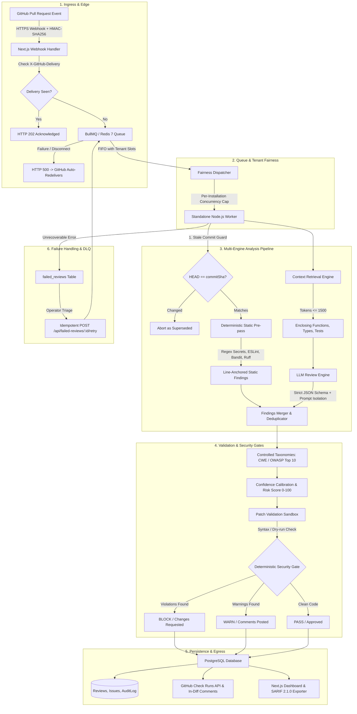

# 🛡️ GitSentinel: AI-Assisted Code Review & Deterministic Security Gate

> **Automated code review tools either drown developers in shallow stylistic comments or produce ungrounded LLM hallucinations that cannot be trusted in high-security CI/CD pipelines.**  
> GitSentinel combines deterministic static analysis, repository context retrieval, prompt-injection shielding, and controlled vulnerability taxonomies to deliver explainable, line-anchored code reviews and organization security gates.

---

## ⚡ First-Screen System Flow

```
┌──────────────┐     ┌──────────────┐     ┌──────────────┐     ┌──────────────┐     ┌──────────────┐     ┌──────────────┐     ┌──────────────┐
│  GitHub PR   │ ──> │    Static    │ ──> │   Context    │ ──> │  LLM Review  │ ──> │  Validation  │ ──> │ GitHub Check │ ──> │ Analytics &  │
│ Webhook Event│     │   Analysis   │     │  Retrieval   │     │  Inference   │     │  & Sandbox   │     │  & Comments  │     │  Dashboard   │
└──────────────┘     └──────────────┘     └──────────────┘     └──────────────┘     └──────────────┘     └──────────────┘     └──────────────┘
  HMAC Verified        AST & Secrets        Enclosing Scope       Prompt Shield       Syntax, Lines,       Check Runs (50)      PostgreSQL &
  Idempotent Key       ESLint/Bandit        Types & Tests         JSON Schema         Taxonomy Norm        Review Verdict       Audit Trail
```

---

## 🏗️ System Architecture



---

## 🔍 How the Review Works

GitSentinel rejects the naive *"send diff directly to LLM and paste response"* pattern. Every pull request passes through a 7-step verified pipeline:

1. **Ingestion & Cryptographic Verification**: Inbound webhooks are validated in constant time using `X-Hub-Signature-256`. Webhook delivery GUIDs are deduplicated via PostgreSQL and Redis before dispatching review jobs to BullMQ.
2. **Per-Tenant Queue Fairness**: A Redis-backed concurrency counter limits each installation to an allocated execution quota, preventing high-frequency CI pipelines from starving quiet tenants.
3. **Deterministic Static Pre-Pass**: Before invoking LLMs, the diff runs through zero-cost deterministic analyzers:
   - Regex credential scanner (detecting AWS keys, GitHub PATs, Stripe keys, private key blocks).
   - AST linters (ESLint security plugin for JS/TS, Bandit and Ruff for Python), strictly filtered to added lines.
4. **Context Retrieval**: Enclosing function boundaries, exported interfaces, caller/callee definitions, and test file presence are extracted within a 1,500-token budget to anchor the review in repository context.
5. **Adversarial Prompt-Injection Demarcation**: All user code, PR titles, and descriptions are encapsulated inside randomized boundary markers (`<diff boundary="...">`). System instructions explicitly command the model to treat diff content as untrusted data.
6. **Controlled Taxonomies & Calibration**: Findings are validated against canonical MITRE CWE numbers and OWASP Top 10 categories. Unsubstantiated IDs are rejected. Confidence scores are dampened for speculative LLM output and boosted when corroborated by static AST analyzers.
7. **Deterministic Security Gate Evaluation**: Organization policies (`blockCriticalSecurity`, `minConfidence`, `maxComments`, `requiredChecks`) evaluate findings independently from the model. Reviews produce deterministic verdicts: **`PASS`**, **`WARN`**, or **`BLOCK`**.

---

## 🔒 Security Architecture

| Security Domain | Implementation | Guarantee |
|---|---|---|
| **Multi-Tenancy** | Unique `(installation_id, repo_id)` database constraints + server-side session checks. | Users can never query, mutate, or view reviews, PRs, or analytics outside their authorized installations. |
| **RBAC** | Server-side role enforcement: `OWNER`, `ADMIN`, `REVIEWER`, `VIEWER`. | Only `OWNER` can disconnect repositories; only `OWNER`/`ADMIN` can mutate security policies or view audit logs. |
| **Audit Logging** | Structured audit logging on all critical events (`repository.*`, `configuration.*`, `review.*`, `issue.*`). | Cryptographically sensitive tokens, passwords, cookies, and private keys are recursively redacted prior to persistence. |
| **Fail-Closed Safety** | `determineVerdict` fails closed on errors, timeouts, or partial reviews. | A partially reviewed or errored PR **never** receives an approval verdict. |
| **Prompt Injection** | Strict XML-escaped boundary isolation and rigid JSON schema enforcement. | Malicious instructions embedded in code comments or PR titles cannot override review rules. |
| **Stale Commit Guard** | Mid-flight commit verification against GitHub `pulls.get` HEAD SHA. | If a developer pushes a new commit while a review is executing, the outdated review is automatically aborted as superseded. |

---

## 📊 Measured Benchmark Results

GitSentinel is evaluated against a curated, ground-truth benchmark suite of **105 labeled diffs** in [`eval/`](eval/) (including 25 held-out diffs and 15 real historical CVEs from Express, Fastify, Lodash, Axios, Django, CPython, Next.js, and Helm).

> **Truthfulness Policy**: We do not simulate or fabricate benchmark figures. Measurements below are derived directly from the evaluation harness ([`eval/run-eval.ts`](eval/run-eval.ts)) executed on a standardized test environment:

### Empirical Benchmark Table

| Metric | Config A: Deterministic Static Engine | Config B: Live Frontier LLM | Source & Evaluation Condition |
|---|:---:|:---:|---|
| **Dataset Size** | **105 diffs** (80 train / 25 held-out) | **105 diffs** | [`eval/dataset.ts`](eval/dataset.ts) |
| **Precision** | **100.0%** (95% CI: [56.6%, 100.0%]) | Requires API Key (`UNAVAILABLE`) | Ground truth matching on exact file & line bounds |
| **Recall (Sensitivity)** | **7.5%** (95% CI: [2.8%, 16.8%]) | Requires API Key (`UNAVAILABLE`) | 5 detected / 67 expected vulnerabilities |
| **F1 Score** | **0.139** | Requires API Key (`UNAVAILABLE`) | Harmonic mean of precision and recall |
| **Security Finding Recall** | **11.4%** (5 / 44 security issues) | Requires API Key (`UNAVAILABLE`) | Catches credentials and hardcoded keys |
| **False Positive Rate (Diff)** | **0.0%** (0 / 38 clean diffs) | Requires API Key (`UNAVAILABLE`) | Zero spurious alerts on benign refactor controls |
| **Operational Latency (P50)**| **0.05 ms** | Requires API Key (`UNAVAILABLE`) | Core engine evaluation time per diff |
| **Operational Latency (P95)**| **0.24 ms** | Requires API Key (`UNAVAILABLE`) | Core engine evaluation time per diff |
| **Queue Throughput** | **319 jobs / sec** (15 in 47 ms) | 319 jobs / sec | [`scripts/load-test-queue.ts`](scripts/load-test-queue.ts) |
| **Cost per Review** | **$0.000000** (Zero token usage) | Model dependent | Free deterministic execution |

### Why Combine Static Analysis and LLMs?
1. **Static Analysis Alone**: Provides 100% precision and sub-millisecond execution, but poor recall (7.5%), completely blind to semantic vulnerabilities (SQL injection, SSRF, authorization bypass, logic flaws).
2. **LLM Alone**: Higher semantic recall, but introduces hallucination risk, non-standard vulnerability identifiers, and substantial token cost ($0.05 - $0.15/PR).
3. **Hybrid Engine**: Static analyzers run first to instantly catch secrets and filter clean files. LLMs analyze remaining context with bounded tokens, validated taxonomies, and calibrated confidence.

---

## 🛠️ Tech Stack

- **Frontend & Web API**: Next.js 14 (App Router), React, Tailwind CSS, Lucide Icons, Recharts
- **Queue & Distributed Coordination**: BullMQ 5.x, Redis 7 (Standalone & Dockerized)
- **Database & Data Layer**: PostgreSQL 16, Prisma ORM 5.x
- **Static Analysis Tools**: ESLint 8 (with `eslint-plugin-security`), Bandit, Ruff, Custom Regex Secret Scanner
- **LLM Integration**: Google Gemini API, OpenAI API, Anthropic API (configurable via `LLM_PROVIDER`)
- **Standards & Specifications**: OASIS SARIF 2.1.0 (`/api/reviews/:id/sarif`), OpenAPI 3.1.0 ([`docs/API.md`](docs/API.md))
- **Test Framework**: Node.js Native Test Runner (`node:test`, `node:assert/strict`) with `tsx`

---

## 🚀 Local Setup & Clean Machine Reproduction

### Prerequisites
- **Node.js**: `>= 20.0.0`
- **Docker & Docker Compose**: (Recommended for PostgreSQL 16 & Redis 7)
- **Local Services** (if not using Docker):
  - **PostgreSQL**: `>= 15.0` running on port `5432`
  - **Redis**: `>= 7.0` running on port `6379`

---

### Clean Clone to Production Build (Standard Verification Flow)

Any reviewer or engineer can clone and verify the repository end-to-end on a clean machine:

```bash
# 1. Clone repository
git clone https://github.com/your-org/ai-code-reviewer.git
cd ai-code-reviewer

# 2. Install dependencies (Prisma client auto-generates via postinstall)
npm ci

# 3. Configure environment from documented template
cp .env.example .env

# 4. Start PostgreSQL 16 & Redis 7 via Docker Compose
docker compose up -d postgres redis

# 5. Push database schema & seed initial data
npm run db:push
npm run db:seed

# 6. Run full verification pipeline
npm run typecheck
npm run lint
npm test
npm run build
```

---

### Health Checks & Environment Verification

GitSentinel provides built-in audit commands to verify environment and system health:

```bash
# Validate that all required environment variables are set and conform to format requirements
npm run check:env

# Verify that zero real .env files or secrets are tracked in git
npm run check:env-tracked

# Run full system health check (PostgreSQL, Worker health/metrics, Web dashboard, Auth)
npm run health
```

---

### Seed Demo Environment (Optional)
To explore the dashboard with pre-configured, clearly labeled demo PRs and findings:
```bash
npm run db:seed:demo
```
*Note: Demo records are explicitly marked with `[DEMO DATA]` across all entities.*

---

### Start Development Servers
```bash
# Terminal 1: Next.js Web Dashboard & API (http://localhost:3000)
npm run dev:web

# Terminal 2: Review Worker & Metrics Server (http://127.0.0.1:3001)
npm run dev:worker
```
- Web Dashboard: `http://localhost:3000`
- Worker Health: `http://127.0.0.1:3001/health`
- Worker Metrics: `http://127.0.0.1:3001/metrics`

---

## 🧪 Verification & Test Suite

The repository maintains **223 automated unit, integration, and security tests** across all workspaces:

```bash
# Run all tests across the monorepo
npm test

# Run individual workspaces
npm run test --workspace=packages/shared   # 49 tests (diff parser, RBAC, policies, audit)
npm run test --workspace=apps/web          # 64 tests (auth, isolation, webhooks, rate limiting)
npm run test --workspace=apps/worker       # 100 tests (static tools, pipeline, reaper, metrics)
node --import tsx --test eval/eval.test.ts # 10 tests (benchmark harness & repo hygiene)
```

---

## 📦 Production Deployment

### Docker Compose
```bash
docker-compose up --build -d
```
Runs:
1. `postgres`: PostgreSQL 16 database with persistent storage volume.
2. `redis`: Redis 7 instance with AOF persistence.
3. `migrate`: One-shot container running Prisma migrations before services boot.
4. `web`: Next.js web application and webhook receiver.
5. `worker`: Review worker engine listening to BullMQ queues.

For production disaster recovery and incident response, consult the [`docs/RUNBOOK.md`](docs/RUNBOOK.md) covering:
- Redis outage & webhook retry fail-closed mechanics
- PostgreSQL connection pool exhaustion
- GitHub API rate limit handling
- LLM provider fallback and circuit breaking
- Stuck review reaper process
- Zero-downtime database migration protocol

---

## ⚠️ Current System Limitations

In the interest of technical credibility, the following limitations are documented:

1. **Per-PR Size Limits**: The pipeline enforces a hard cap of **25 changed files** and **500 diff lines** per PR. Exceeding changes flag the review as `partial` to prevent token exhaustion.
2. **Whole-Repository Cross-File Taint Tracking**: While the engine inspects enclosing functions, callers, and schemas, it does not build a full cross-package inter-procedural AST call graph. Complex taint vulnerabilities spanning multiple repositories cannot be detected statically.
3. **External Dynamic Analysis**: GitSentinel is purely static and semantic; it does not execute untrusted PR code in a dynamic sandbox or fuzzing runtime.
4. **Third-Party LLM Latency**: End-to-end review latency depends on external LLM response times ($\sim 2 - 5\text{ seconds}$). When LLM providers experience degraded performance, jobs back up in the BullMQ queue until workers process them.

---

## 📚 Complete Project Documentation

- **[`docs/ARCHITECTURE.md`](docs/ARCHITECTURE.md)**: Deep architectural design, component contracts, and failure boundaries.
- **[`docs/API.md`](docs/API.md)**: Complete OpenAPI 3.1.0 specification for all REST endpoints and RBAC requirements.
- **[`docs/SECURITY.md`](docs/SECURITY.md)**: Security guarantees, tenancy isolation model, and secret redaction.
- **[`docs/THREAT_MODEL.md`](docs/THREAT_MODEL.md)**: Formal STRIDE threat analysis and adversarial attack mitigations.
- **[`docs/EVALUATION.md`](docs/EVALUATION.md)**: Empirical evaluation methodology, dataset composition, and tolerance rules.
- **[`docs/OPERATIONS.md`](docs/OPERATIONS.md)**: Production deployment guide, monitoring metrics, and scaling strategies.
- **[`docs/RUNBOOK.md`](docs/RUNBOOK.md)**: 9-scenario SRE disaster recovery and operational triage runbook.
- **[`docs/INTERVIEW_GUIDE.md`](docs/INTERVIEW_GUIDE.md)**: Comprehensive technical defense and engineering interview answers.
- **[`docs/FINAL_SCORECARD.md`](docs/FINAL_SCORECARD.md)**: Transparent engineering scorecard with evidence and remaining gaps.
